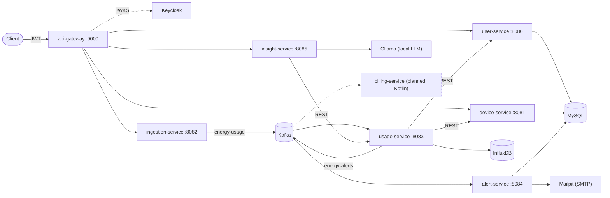

# Home Energy Tracker


Event-driven microservices system that collects energy readings from smart-home devices,
streams them through Kafka, stores time series in InfluxDB, alerts users by email when
consumption exceeds their threshold, and generates AI saving tips with a local LLM.

> **Attribution.** This project started from the open tutorial
> [leetjourney/home-energy-tracker](https://github.com/leetjourney/home-energy-tracker)
> (CC BY-NC 4.0). I have since modified and extended it — see
> [Changes vs. the original](#changes-vs-the-original) and the [Roadmap](#roadmap).

---

## Architecture



**Flow:** readings are posted to `ingestion-service` → published to the `energy-usage` topic →
`usage-service` writes them to InfluxDB and periodically aggregates usage per user → if a
user's threshold is exceeded it publishes to `energy-alerts` → `alert-service` sends an email
and records the alert. All public traffic goes through `api-gateway`, which validates JWTs
issued by Keycloak and protects downstream services with circuit breakers.

## Tech stack

| Area | Technologies |
|---|---|
| Core | Java 21, Spring Boot 4.1, Maven |
| Messaging | Apache Kafka 4.3 (KRaft), Spring for Apache Kafka |
| Gateway & resilience | Spring Cloud Gateway (Server WebMVC), Resilience4j circuit breakers |
| Security | OAuth2 Resource Server, Keycloak 24 (client credentials) |
| Storage | MySQL (Flyway migrations), InfluxDB 2 (time series) |
| AI | Spring AI 2.0 + Ollama |
| Observability | Actuator, Micrometer, Prometheus, Grafana |
| API docs | springdoc-openapi, aggregated Swagger UI in the gateway |
| Testing | JUnit 5, Testcontainers |
| Local infra | Docker Compose, Kafka UI, Mailpit |

## Services

| Service | Port | Responsibility |
|---|---|---|
| api-gateway | 9000 | Single entry point: routing, JWT validation, circuit breakers, aggregated API docs |
| user-service | 8080 | User accounts and alerting preferences |
| device-service | 8081 | Registry of user devices |
| ingestion-service | 8082 | Accepts energy readings over HTTP and publishes them to Kafka (includes a load simulator) |
| usage-service | 8083 | Stores readings in InfluxDB, aggregates usage, raises threshold alerts |
| alert-service | 8084 | Consumes alerts from Kafka, sends emails, stores alert history |
| insight-service | 8085 | Energy saving tips generated by a local LLM |

---

## Getting started

### Prerequisites

- JDK 21
- Docker with Docker Compose
- [Ollama](https://ollama.com/) — only for `insight-service`: `ollama pull deepseek-coder`

### 1. Start the infrastructure

```bash
docker compose up -d
```

The Keycloak realm (`het-security-realm`) is imported automatically from
`docker/keycloak/realms/`.

### 2. Run the services

Each service is a standalone Maven project with its own wrapper:

```bash
cd user-service && ./mvnw spring-boot:run
```

Repeat for the other services (or run them from your IDE).

### 3. Get a token and call the API

The realm ships with a confidential client `home-energy-tracker-client`. Its secret is in
`docker/keycloak/realms/het-security-realm-realm.json` — **local development only**.

```bash
TOKEN=$(curl -s -X POST \
  http://localhost:8091/realms/het-security-realm/protocol/openid-connect/token \
  -d grant_type=client_credentials \
  -d client_id=home-energy-tracker-client \
  -d client_secret=<secret-from-realm-json> | jq -r .access_token)

curl -H "Authorization: Bearer $TOKEN" http://localhost:9000/api/v1/user/1
```

### Local UIs

| Tool | URL | Credentials |
|---|---|---|
| Swagger UI (all services) | http://localhost:9000/swagger-ui.html | — |
| Kafka UI | http://localhost:8070 | — |
| Mailpit (alert emails) | http://localhost:8025 | — |
| Grafana | http://localhost:3000 | admin / admin |
| Prometheus | http://localhost:9090 | — |
| Keycloak admin | http://localhost:8091 | admin / admin |
| InfluxDB | http://localhost:8072 | admin / admin123 |

---

## Changes vs. the original

- Fixed a broken JWT issuer property in the gateway (`jwt,issuer-uri` → `jwt.issuer-uri`)
- Upgraded all services to Spring Boot 4.1; `insight-service` migrated from Boot 3.5 / Spring AI 1.1 to Boot 4.1 / Spring AI 2.0
- OpenAPI docs for `ingestion-service` and `insight-service`, aggregated in the gateway Swagger UI
- Logging and execution-time aspects in `device-service`
- RESTful device creation endpoint (`POST /api/v1/device` instead of `POST /create`)
- Keycloak persisted to MySQL (the original config used env variables Keycloak 24 ignores) and realm exported to the repo, so a fresh clone works end to end
- Fixed MySQL init script syntax, pinned infrastructure image versions, removed a duplicated/unused Docker volume
- Centralized error handling: RFC 9457 problem details in all HTTP services, field-level validation errors, 409 on data conflicts, 502/503 when a dependency is unavailable
- Fixed tutorial bugs: all gateway routes shared one fallback path, NPE in insight-service for users without devices, LLM system prompt was never applied, alert history recorded wrong results on database errors

## Roadmap

**Error handling & API quality**
- [X] `@RestControllerAdvice` with RFC 9457 `ProblemDetail` in all HTTP services
- [X] Bean Validation on request DTOs; proper `201 Created` + `Location`, `404`, `409`
- [X] Fix gateway fallbacks (all routes currently share one fallback path)
- [X] Fix NPE in `insight-service` when a user has no devices

**Testing & CI**
- [ ] Unit tests for threshold/alerting logic
- [ ] `@WebMvcTest` slices for controllers and error handling
- [ ] Testcontainers integration tests for Kafka and InfluxDB, WireMock for service clients
- [ ] GitHub Actions pipeline with test coverage report (JaCoCo)

**Kafka hardening**
- [ ] Message keys (`deviceId`) for per-device ordering, idempotent producer
- [ ] Retries with backoff and dead-letter topics (`DefaultErrorHandler`, `ErrorHandlingDeserializer`)
- [ ] Migrate to Jackson 3 serializers; explicit type mapping instead of shared package names
- [ ] Alert de-duplication (cooldown per user) — currently an exceeded threshold triggers an email on every aggregation run

**New service**
- [ ] `billing-service` in **Kotlin**: hourly windowed aggregation with **Kafka Streams**, day/night tariffs, monthly bills, own PostgreSQL database

**Deployment**
- [ ] Multi-module Maven build
- [ ] Container images for all services; run the whole system with one `docker compose` command
- [ ] Kubernetes manifests (kind)

## Known limitations

- Several services share one MySQL schema, and migrations for `device` and `alert` tables live in `user-service`. A production setup would use a database per service.
- Service URLs are hard-coded to `localhost`; they will move to environment-based configuration together with containerisation.
- `usage-service` resolves device owners with one HTTP call per device on every aggregation run (to be replaced by the Kafka Streams aggregation above).

## License

[CC BY-NC 4.0](LICENSE), inherited from the original tutorial.